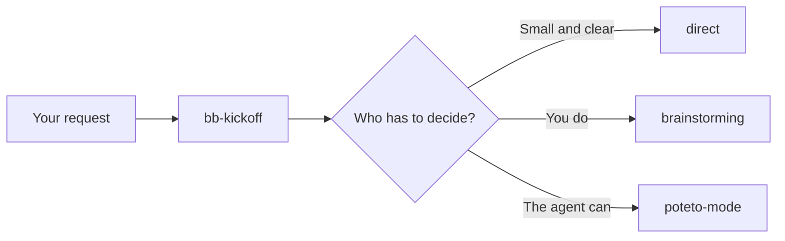

# skills-bb

[](https://skills.sh/siapble/skills-bb)

`bb-kickoff` is an agent skill that decides how a development task should be handled before the agent starts on it.

## The problem

Coding agents can work in very different ways. Some workflows stop and ask you about every choice. Others make the choices themselves and only show you the result. Picking the wrong one costs you either a long round of questions about a typo, or a finished feature that solves the wrong problem.

`bb-kickoff` makes that pick for you, says which one it picked and why, and hands the task over.

## The idea

Route by who has to decide, not by how big the task is.

A one-line change to the default currency still needs you to say which currency. A rename across 300 files needs nobody's opinion. So the first goes to you and the second goes to the agent.

## Three routes

| Route | What the agent does | When it fits |
|---|---|---|
| `brainstorming` | Asks questions, proposes options, and waits for your approval before building anything. | You still have decisions to make. |
| `poteto-mode` | Investigates, decides from evidence, and delivers code it has verified. | The goal is clear and the effort is in doing it well. |
| `direct` | Does the task and reports what it changed and checked. | The task is small and clear. |



`brainstorming` comes from [superpowers](https://github.com/obra/superpowers) and `poteto-mode` comes from [pstack](https://github.com/backnotprop/pstack). This repository does not copy them. You install them yourself.

## Install

```bash
npx skills add siapble/skills-bb -a claude-code cursor --copy
```

The skills CLI asks for Node.js 22.20 or later.

## Required skills

Install both of these once.

| Agent | superpowers (`brainstorming`) | pstack (`poteto-mode`) |
|---|---|---|
| Claude Code | `/plugin install superpowers@claude-plugins-official` | `/plugin marketplace add michael-denyer/pstack-claude` then `/plugin install pstack@pstack-claude` |
| Cursor | `npx skills add obra/superpowers -a cursor --copy` | `/add-plugin pstack` |
| Other agents | `npx skills add obra/superpowers --copy` | `npx skills add backnotprop/pstack --copy` |

The Claude Code command for pstack installs `michael-denyer/pstack-claude`, a third-party build of pstack for Claude Code. In that build the agent can start `poteto-mode` itself.

The Cursor plugin and the skills CLI copy of pstack mark `poteto-mode` so that only you can start it. The agent cannot see a skill marked this way, so it reports `poteto-mode` as missing. Its message also tells you that, if pstack is already installed, you can type `/poteto-mode` followed by your request.

If one of the two is missing, `bb-kickoff` tells you which one, shows the command from this table, and stops. It does not install anything, and it does not do the missing skill's job itself. It may name a skill you already have that could do the job instead, and leave the choice to you.

## What you see

You ask for something:

```
The save button crashes when clicked
```

The agent answers with one line and then starts that route:

```
Route: poteto-mode (rule 5) because this is a bug and its cause is not known yet
```

If an assumption decided the route, a second line says so:

```
Assumes: the export format is already agreed in the ticket
```

If the task includes an operation that needs your authorization, another line says so:

```
Authorization: required before dropping the legacy_orders table
```

If you disagree, name the route you want and the agent switches. Requests that are not development work, such as "translate this email", get a plain answer with no `Route:` line.

## Safety boundary

Before routing, `bb-kickoff` checks whether the task includes an operation that needs your authorization. That covers high-impact operations, not only destructive ones. The check holds on every route, including one you named, and it does not change which route is picked.

| Operation | Examples | What happens |
|---|---|---|
| Low risk or reversible | Local code, local config | Nothing extra |
| High impact, recoverable | A production deploy, a release, an infrastructure change, an operational config change, rotating a credential with a tested replacement and an overlap period | Normal routing. Authorization required, unless you asked for this exact operation and a tested rollback is known |
| Destructive or irreversible | Permanently deleting data, a destructive migration, destroying infrastructure, rewriting shared Git history, revoking a live credential with no working replacement or no way to recover access | Authorization required |

The agent judges an operation by what it would actually break and whether it can be undone, not by its name. A credential rotation is recoverable when the new credential is tested and services switch over before the old one stops working. Revoking a credential that something still needs, with no way back, is destructive.

Picking a route, approving a plan, and authorizing an operation are three separate decisions. When authorization is required, the agent still investigates, reviews, plans, and prepares, as long as none of that changes a shared or production system. Right before the operation runs, it shows you the exact command and target and waits for your yes. Your request, the route, and an approved plan do not count as that yes.

## Rules

`bb-kickoff` checks these in order and stops at the first one that matches.

| # | Your request | Route |
|---|---|---|
| 1 | You asked for `direct`, `brainstorming`, or `poteto-mode` by name. The safety boundary still applies | the one you asked for |
| 2 | A destructive or irreversible operation on a shared or production system, as the safety boundary defines it | `brainstorming` |
| 3 | A one-file change with an obvious fix, a docs or config edit that changes no behavior, or a question of fact the agent can answer by reading, including how existing code works | `direct` |
| 4 | The result is not code. Having a git repository or not does not decide the route. An operation on a running system does not count here | `brainstorming` for something new, `direct` for a fix or change to something that exists |
| 5 | A bug, a slowdown, a refactor, an investigation you asked for, pull request upkeep, picking up work from another session, a task to run unattended, or an engineering operation such as a deploy or a release whose goal and procedure are clear | `poteto-mode` |
| 6 | New or changed behavior, or an engineering operation, and you still have to decide who it is for, how far it goes, what done means, which of two conflicting requirements wins, or a product or architecture choice | `brainstorming` |
| 7 | New or changed behavior with nothing left for you to decide, including questions the agent can answer by running or measuring something | `poteto-mode` |

Rule 3 is judged from the request alone. It does not apply when:

- nobody knows yet where the problem is,
- the change is a security fix,
- answering means running or measuring something, as in "is cache A or B faster?",
- you ask for an investigation or ask whether something is certain, as in "are we sure this handles expired tokens?",
- the question is about what should be built, as in "what should the dashboard show?". That is a decision for you,
- the task changes a shared or production system.

A deploy or release does not go to `brainstorming` just because it touches production. Routing it to `poteto-mode` lets the agent prepare. It does not let the agent run it. The safety boundary decides that.

Engineering choices, such as which library, how to structure the code, or what to name things, are the agent's to make. Only product choices and conflicts count as decisions for you in rule 6.

You can rule a route out, as in "do not use poteto-mode". If the rules land on that route anyway, the agent checks the remaining routes and takes one only if the same person still decides and it can do the job:

- `direct` ruled out: the agent uses `poteto-mode`.
- `poteto-mode` ruled out: the agent uses `direct` only when the cause and location are known and the change can be verified in one pass, and says so.
- `brainstorming` ruled out: a decision is still yours, so no other route fits.

When nothing fits, the agent says why and asks you one question, such as making the open decision now or allowing the route you ruled out.

## Examples

| Request | Route | Rule |
|---|---|---|
| "Fix the typo in README.md" | `direct` | 3 |
| "How does the login flow work in this repo?" | `direct` | 3 |
| "Rename the local variable tmp to retryCount in src/net/retry.ts" | `direct` | 3 |
| "The app crashes when I log in" | `poteto-mode` | 5 |
| "This SQL query takes 40 seconds. Make it faster." | `poteto-mode` | 5 |
| "Research whether we need Redis for session storage" | `poteto-mode` | 5 |
| "Rename the package com.acme.old across all 300 files" | `poteto-mode` | 5 |
| "Build a notification system" | `brainstorming` | 6 |
| "Change the default currency shown to all users" | `brainstorming` | 6 |
| "Build the notification system exactly as specified in docs/notifications-spec.md" | `poteto-mode` | 7 |
| "Deploy the tagged release v1.4 to production with the documented release script" | `poteto-mode`, authorization required before the deploy | 5 |
| "Drop the legacy_orders table from the production database" | `brainstorming` | 2 |
| "Use poteto-mode to fix the typo in README.md" | `poteto-mode` | 1 |

## Several tasks in one request

Each task gets its own `Route:` line, and the agent works through them in the order you gave.

```
Fix the typo in README.md, then find out why search is slow, then add a notification system
```

```
Route: direct (rule 3) because the typo fix is one file with an obvious change
Route: poteto-mode (rule 5) because the slowdown has an unknown cause
Route: brainstorming (rule 6) because you still have to decide what the notifications cover
```

Before it starts a later task, the agent checks whether an earlier one changed what that task needs. If it did, it routes the task again and prints a new `Route:` line. It reuses what earlier tasks found instead of reading the same code again.

## After brainstorming

`brainstorming` ends with a written plan that you approve. If that plan touches more than one file, or has to be checked against the running system, `bb-kickoff` tells the agent to build it through `poteto-mode`. Smaller plans are built the way the plan itself proposes.

## Make agents call bb-kickoff

An agent will not always call `bb-kickoff` by itself. To make it the first step, add this line to the `AGENTS.md` of each project:

```
Before starting any development task, invoke the bb-kickoff skill and follow its route.
```

Cursor reads `AGENTS.md`. For Claude Code, add `@AGENTS.md` to the project's `CLAUDE.md`.

## Agent compatibility

| Agent | Finds the skill | Starts `poteto-mode` itself | Routing last checked |
|---|---|---|---|
| Claude Code | Yes, from `.claude/skills/` | Yes with `pstack-claude`. No with the skills CLI copy, so you type `/poteto-mode` | 0.2.0 rules, automated runs |
| Cursor | Yes, from `.agents/skills/` | No, the Cursor plugin marks it for you to start | 0.1 rules, by hand |
| Codex | Not tested | Not tested | Not tested |

The rules changed in 0.2.1 and 0.2.2 have not been rechecked on either agent.

## Limitations

- The agent's choice comes from a language model, so the same request can be routed differently on different runs.
- Nothing forces an agent to call `bb-kickoff`. The `AGENTS.md` line makes it likely, not certain.
- This repository has no automated routing tests.
- The rules were written against superpowers and pstack as of November 2026. If either changes how it works, the rules may need updating.
- The install commands for Claude Code and Cursor plugins were checked against installed copies, not run on a clean machine.

## Cost

`poteto-mode` uses more tokens than the other two routes. It hands most of the work to subagents, and by default it runs bug and performance work on a large model.

## Contributing

Read [AGENTS.md](AGENTS.md) first. Change a rule in `skills/bb-kickoff/SKILL.md` and this README together, and run the checks listed in `AGENTS.md` before you open a pull request.

## Version history

See [CHANGELOG.md](CHANGELOG.md).

## License

MIT. See [LICENSE](LICENSE).
